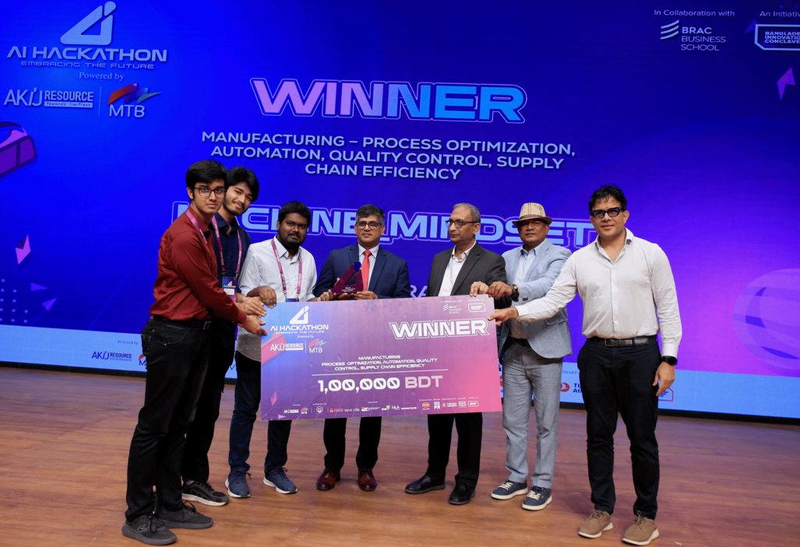

### Hi there, I'm [Md. Hasnain Ali](https://mdhasnainali.com)

## AI Engineer — ML Systems, MLOps/DevOps & Applied Research
I care more about understanding how things work than just making them work. That curiosity started during my undergrad at the University of Rajshahi, where I spent long nights on computer vision research for medical imaging — not just training models, but digging into *why* they made the decisions they did. It later pulled me toward Large Language Models and AI agents, and now toward how these systems move beyond the cloud into the physical world through IoT, edge devices, and robotics.

Day to day, I turn research ideas into systems people actually use — building ML/LLM pipelines and the deployment infrastructure, MLOps, and DevOps practices that keep them reliable in production. But the part I enjoy most is still the research itself: getting stuck on an idea for days and finally watching it click.

Feel free to reach out and connect!

📖 **Currently:** AI Engineer at [Vivasoft Limited](https://vivasoftltd.com/), building and deploying production ML/LLM systems

📍 **Research Focus:** Efficient, interpretable AI systems — LLM/agent inference optimization, MLOps & DevOps for ML infrastructure, and edge/IoT/robotics deployment

🎓 **Next Chapter:** Working toward a PhD in AI systems research — efficiency, interpretability, and real-world robustness beyond the benchmark

## 📚 Published Papers
- **[Geo-HySTE: Geometric hybrid spatio-temporal encoder for enhanced 3D human pose estimation](https://www.sciencedirect.com/science/article/abs/pii/S0045790626004453)**

    Sanjoy Kumar, Sangeeta Biswas, Md Ahanaf Arif Khan, **Md Hasnain Ali**, Mehedi Hasan Shakil
      Computers and Electrical Engineering, Vol. 139, Article 111375, November 2026

- **[Interpreting Deep Neural Networks in Diabetic Retinopathy Grading: A Comparison with Human Decision Criteria](https://doi.org/10.3390/life15091473)**

    Sangeeta Biswas, Md. Ahanaf Arif Khan, **Md. Hasnain Ali**, Johan Rohdin, Subrata Pramanik, Md. Iqbal Aziz Khan, Sanjoy Kumar Chakravarty, Bimal Kumar Pramanik
      Life, Vol. 15, No. 9, Article 1473, September 2025

- **[Competency Comparison of Deep Neural Networks for Identifying Gender in Color Fundus Photographs](https://doi.org/10.1109/ICCIT60459.2023.10441623)**

    Md. Ahanaf Arif Khan, **Md. Hasnain Ali**, Nirjor Saha, Md. Sadman Shakib Shoumik, Sangeeta Biswas
      2023 26th International Conference on Computer and Information Technology (ICCIT), 13-15 December 2023, Cox's Bazar, Bangladesh

## 🏅 Certifications

## 🌐 Socials

    

---

    
    
    

## 🏆 Recent Achievement

> 🥇 **Winner – AI Hackathon 2025**
> Developed **VisionDesk**, an AI-driven surveillance solution for manufacturing and industrial environments.
> Leveraged advanced **pose estimation** and **activity recognition** to distinguish productive behaviors (e.g., assembling, typing) from non-productive actions (e.g., idling, phone usage).
> Provided actionable insights to optimize workforce efficiency, process automation, quality control, and supply chain performance.
